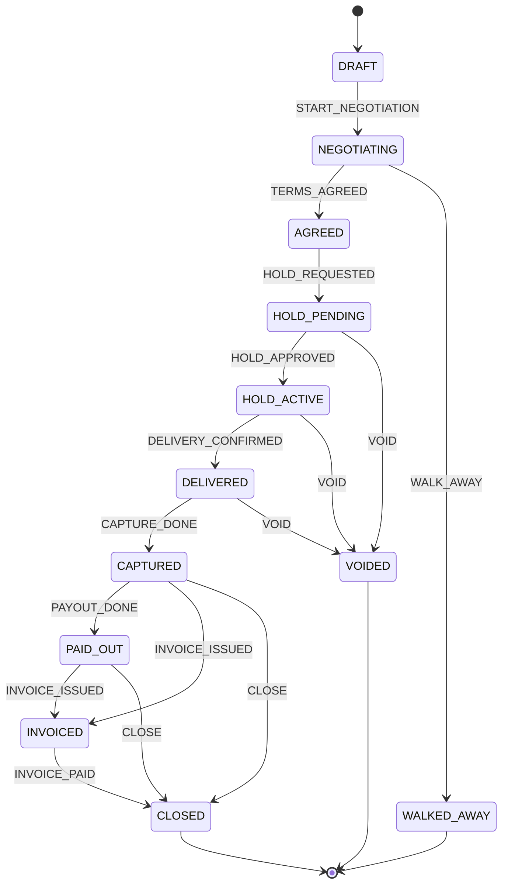
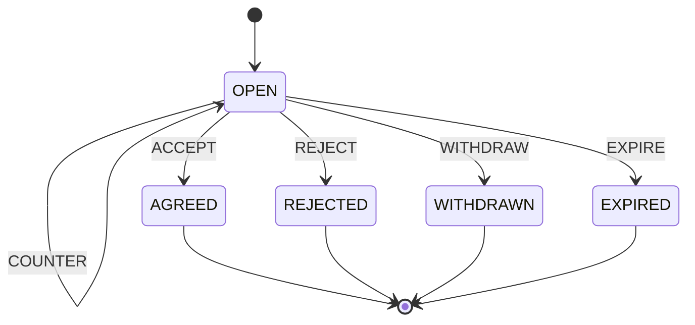

# State machines

Every lifecycle in Deals is a table in `deals/domain/`, read by the services, the deal page,
the JSON API, the agents' tool menus and this document. To change a rule, change the table.

The block between the markers below is generated. Refresh it with

```sh
python manage.py machines --write docs/STATE_MACHINES.md
```

`tests/test_machines.py` fails if it is stale.

<!-- machines:start -->
#### `deal`



#### `negotiation`



#### Stages (what the deal page and `GET /api/deals/<id>` show)

| Stage | Deal states | Waiting on | Next actions |
|---|---|---|---|
| `negotiating` | DRAFT, NEGOTIATING | client | `POST /offers` |
| `agent_negotiating` | NEGOTIATING, while an agent-to-agent negotiation is OPEN | agents | none |
| `agreed` | AGREED | agent | `POST /advance` |
| `approval` | HOLD_PENDING | client | `GET <approve_url>` |
| `held` | HOLD_ACTIVE | client | `POST /delivery`, `POST /cancel` |
| `delivered` | DELIVERED | agent | `POST /advance` |
| `captured` | CAPTURED | paypal | `POST /refresh` |
| `payout_issue` | CAPTURED, while any payout item has failed | owner | `POST /refresh` |
| `paid` | PAID_OUT | nobody | none |
| `invoiced` | INVOICED | client | none |
| `closed` | CLOSED | nobody | none |
| `voided` | VOIDED | nobody | none |
| `walked_away` | WALKED_AWAY | nobody | none |

#### Payout item statuses

- done: `SUCCEEDED`
- failed (a person must look): `BLOCKED`, `CANCELED`, `DENIED`, `FAILED`, `REFUNDED`, `RETURNED`, `REVERSED`
- not yet, nothing to record: `PENDING`, `PROCESSING`
- anything else (on hold, unclaimed, unknown): waiting
<!-- machines:end -->

Paths in the stage table sit under `/api/deals/<id>`.

## The machines, and where each one was hiding

| Machine | It used to be | Now |
|---|---|---|
| Deal state | Explicit (`states.py`) | Same table, run through the shared `Machine` |
| Negotiation status | A bare string with no declared values, an unused `STATUSES` tuple, a `CLOSING` dict, and `"OPEN"` literals in four files | `negotiation_machine.py`; the model declares `choices`; closing goes through `NEGOTIATION.step` |
| Negotiation turn | An `if` chain in `check_turn`, re-derived by both agents and the hosted provider | `SENDER`, `legal_moves`, `turn`; served to agents (below) |
| Lapsed proposal | Invisible: a negotiation stays OPEN until someone next writes to it | `lapsed` flag on every negotiation view |
| Deal stage | `stage_of` re-scanned the whole ledger on every 3 s poll; precedence was the order of a tuple; a 9-branch template `if/elif` | `stage.py` table derived from the deal state; 13 stages |
| Payout item | Free-text status, `LOOKUP_TO_EVENT`, `STILL_WAITING`, and `== "SUCCEEDED"` in three places | `payout.py`: three buckets (done, failed, waiting) and a `payouts` summary |
| Webhook event | A boolean plus the event-type prefix, which together hold three states | `stored_status`: applied, ignored, unapplied |
| Hold approval | A `TermsMismatch` was swallowed by the web layer, so the page looked like "still waiting" | Recorded in the ledger as a refused `confirm_hold` |
| Browser request cycle | A clicked button stayed disabled forever if the request or refresh failed | Controls re-enable when the request finishes |

## What agents can now read

`GET /api/negotiations/<id>` adds `turn` (the role whose answer is awaited, `null` once closed),
`lapsed`, `you`, `your_move` and `can_send` (the message types you may send right now).
`GET /api/negotiations` adds `turn`, `lapsed`, `your_move` and `can_send` per item. Refusals
`CLOSED`, `ALREADY_OPEN`, `NOT_YOUR_TURN` and `NOT_YOUR_PROPOSAL` carry `allowed`, the same list.

`lapsed: true` means the standing proposal's expiry has passed but nothing has closed the
negotiation yet. `can_send` is empty, and the next message returns `410 EXPIRED`.

`GET /api/deals/<id>` adds `waiting_on`, `next` (each item has `name`, `method`, `href`),
`payouts` (`total`, `waiting`, `done`, `failed`, `needs_attention`) and `standing` (the latest
proposal of an agent-to-agent negotiation, else `null`). `stage` gains four values:
`agent_negotiating`, `payout_issue`, `invoiced` and `closed`.

All additions are new keys; no existing key changed meaning.

## Known gaps, found but deliberately not changed

These are product decisions, not refactors.

1. **`INVOICED` and `CLOSED` are unreachable at runtime.** No service issues `INVOICE_ISSUED`,
   `INVOICE_PAID` or `CLOSE`; only the tests do.
2. **A deal with no sub-contractor payouts stays `CAPTURED` forever.** `PAYOUT_DONE` fires only
   when a payout item succeeds. The machine already has `CAPTURED -> CLOSE`, which may be the
   intended exit. Against the fake PayPal adapter the agent's `send_payouts` reports success and
   the deal stays `CAPTURED`; real PayPal's answer to an empty batch is unverified.
3. **A hold can outlive its PayPal authorization.** `authorization_expires` is stored as a
   string and never checked, so `HOLD_ACTIVE` has no expiry edge.
4. **A failed hold approval has no recovery edge.** After a `TermsMismatch` the deal is still
   `HOLD_PENDING` and shows the old approve link, whose PayPal hold was released.
5. **A bad credential is always a bare 401.** Active, expired, revoked and agent-paused are four
   states that `authenticate_agent` collapses into `None`, so an agent cannot tell why.
6. **Negotiations expire lazily.** A lapsed proposal is only closed when someone next writes to
   it; the `lapsed` flag makes that visible but does not close it.
7. **Payout item statuses follow PayPal's documented names**, which `LEARNING.md` lists as not yet
   verified against live webhooks. An unknown status is treated as waiting, never failed.
